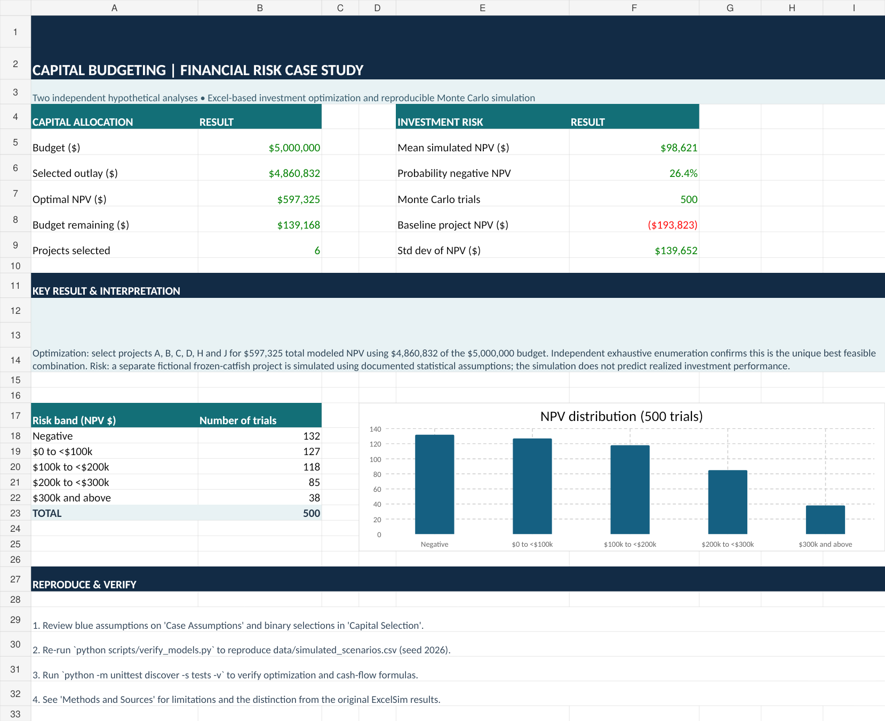

# Capital Budgeting and Investment Risk Analysis

This repository contains two Excel finance exercises. The first asks which projects to fund when capital is limited. The second looks at how changes in sales volume, selling price, and costs affect the NPV of a five-year operating investment. They are separate hypothetical cases, not forecasts for an actual business.

I rebuilt the original coursework workbook with labeled inputs and visible formulas, then used Python to check the results independently.



**[Open the Excel workbook](Capital_Budgeting_and_Investment_Risk.xlsx)** | [Assumptions and calculation notes](METHODOLOGY.md)

## Capital allocation

Ten projects compete for a $5 million budget. Each has an initial cost and an estimated net present value (NPV). The decision is which projects to select without exceeding the budget.

The Excel sheet uses binary selection cells (0 = exclude, 1 = include). A Python script checks every one of the 1,024 possible combinations, including the infeasible ones, rather than relying only on a saved Solver answer.

| Result | Value |
| --- | ---: |
| Projects selected | A, B, C, D, H, J |
| Capital used | $4,860,832 |
| Total modeled NPV | **$597,325** |
| Unspent budget | $139,168 |
| Combinations within budget | 451 of 1,024 |

The selected combination is the only one with the highest NPV under the stated assumptions. To try a different selection, change the 0/1 cells in the `Capital Selection` sheet. The totals update automatically; selecting a new optimum requires running Solver or the Python checker again.

## Five-year project risk

The second exercise models a frozen-catfish investment. It starts with a $650,000 outlay and estimates operating cash flows for five years. The simulation varies three inputs:

| Variable | Assumed distribution |
| --- | --- |
| First-year volume | Normal: mean 200,000 lb; SD 25,000 lb |
| Selling price | Normal: mean $2.50/lb; SD $0.50/lb |
| Variable costs as a share of revenue | Uniform: 55% to 65% |

Other assumptions include 8% annual volume growth, $80,000 in yearly fixed costs, a 35% tax rate, and a 10% discount rate. Full cash-flow and terminal-value calculations are in [METHODOLOGY.md](METHODOLOGY.md).

I generated 500 scenarios with Python's `random.Random(2026)` so the inputs can be reproduced. The same inputs appear in the workbook, where Excel calculates each trial's NPV.

| Simulation summary | Result |
| --- | ---: |
| Mean NPV | $98,621 |
| Sample NPV standard deviation | $139,652 |
| Trials with negative NPV | 132 of 500 (26.4%) |

These are outcomes under the chosen assumptions, not estimates of the project's real-world failure rate. The old coursework file contained ExcelSim summary results but not the individual draws needed to check them. I did not reuse those figures; this version publishes the scenario inputs and calculations.

## Reproduce the checks

The Python code uses the standard library and runs with Python 3.10 or later:

```bash
python scripts/verify_models.py
python -m unittest discover -s tests -v
```

The script writes `data/simulated_scenarios.csv` and `data/validation_results.json`. Tests cover the capital-allocation result, baseline cash-flow calculation, alternative NPV formula, and fixed-seed simulation. GitHub Actions runs these checks on Python 3.11, 3.12, and 3.13.

The workbook is a saved set of 500 scenario inputs. Rerunning Python recreates the companion data files; it does not rewrite the Excel workbook. If you change the simulation assumptions, refresh the inputs in Excel to keep the two versions consistent.

## Files

- [`Capital_Budgeting_and_Investment_Risk.xlsx`](Capital_Budgeting_and_Investment_Risk.xlsx): Excel model and overview sheet.
- [`METHODOLOGY.md`](METHODOLOGY.md): Cash-flow formulas, assumptions, limitations, and source notes.
- [`scripts/verify_models.py`](scripts/verify_models.py): Exhaustive capital-selection check and simulated cash flows.
- [`tests/test_financial_model.py`](tests/test_financial_model.py): Automated tests.
- [`data/`](data/): Scenario inputs, NPV results, and validation summary.

All figures are illustrative. This work does not represent investment performance, cost savings, or financial analysis completed for an employer.
